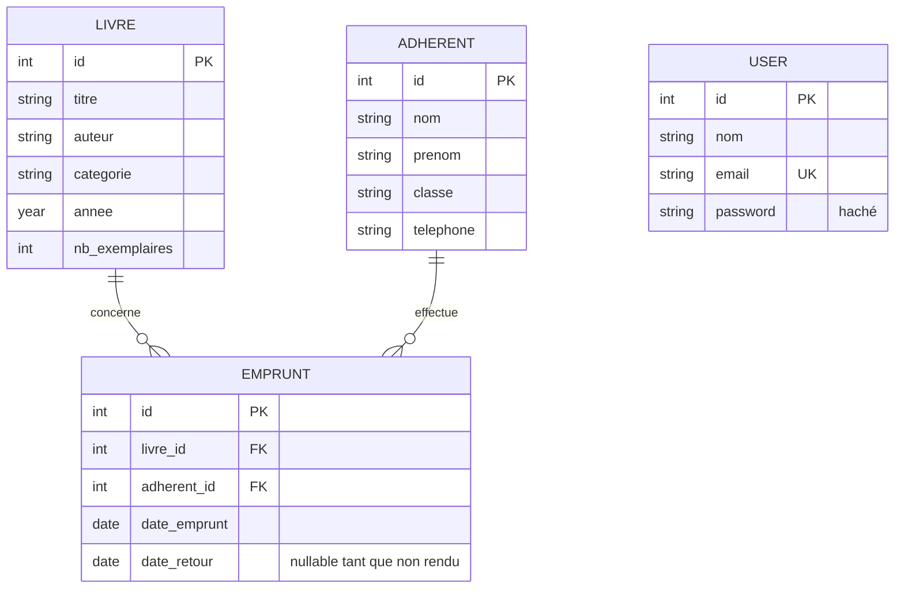

# BiblioNet — Conception J1

## 1. MCD



Un livre peut être concerné par zéro ou plusieurs emprunts ; chaque emprunt concerne exactement un livre. Un adhérent peut effectuer zéro ou plusieurs emprunts ; chaque emprunt appartient à exactement un adhérent. `USER` représente le compte du bibliothécaire et n'est pas relié aux emprunts dans le périmètre actuel.

## 2. MLD

- `users(id, nom, email, password)` — `id` clé primaire ; `email` unique.
- `livres(id, titre, auteur, categorie, annee, nb_exemplaires)` — `id` clé primaire.
- `adherents(id, nom, prenom, classe, telephone)` — `id` clé primaire.
- `emprunts(id, livre_id, adherent_id, date_emprunt, date_retour)` — `id` clé primaire ; `livre_id` référence `livres.id` ; `adherent_id` référence `adherents.id` ; `date_retour` est nullable.

La disponibilité est calculée et n'est pas stockée : `livres.nb_exemplaires - nombre d'emprunts du livre dont date_retour est NULL`. Un emprunt doit être refusé si le résultat est nul.

## 3. Maquettes rapides

### Catalogue public

```text
+------------------------------------------------------+
| BiblioNet      Catalogue                  Connexion |
+------------------------------------------------------+
| Catalogue de la bibliothèque                         |
| [ Rechercher par titre ou auteur... ] [Rechercher]   |
|                                                      |
| +----------------+ +----------------+ +------------+ |
| | Titre          | | Titre          | | Titre      | |
| | Auteur, année  | | Auteur, année  | | Auteur     | |
| | Disponible     | | Indisponible   | | Disponible | |
| +----------------+ +----------------+ +------------+ |
+------------------------------------------------------+
```

### Connexion bibliothécaire

```text
+--------------------------------------+
| BiblioNet                             |
| Connexion                             |
| Adresse e-mail [__________________]  |
| Mot de passe   [__________________]  |
|                         [Se connecter]|
+--------------------------------------+
```

### Gestion (livres, adhérents ou emprunts)

```text
+------------------------------------------------------+
| BiblioNet | Catalogue | Livres | Adhérents | Emprunts|
+------------------------------------------------------+
| Gestion des [éléments]             [+ Ajouter]       |
| [Rechercher...]                                      |
|------------------------------------------------------|
| Liste des éléments avec leurs informations           |
| Actions par ligne : [Modifier] [Supprimer/Retour]    |
+------------------------------------------------------+
```

### Formulaire de création / modification

```text
+--------------------------------------+
| Ajouter / modifier [élément]         |
| Champs adaptés au formulaire         |
|                         [Enregistrer] |
|                         [Annuler]     |
+--------------------------------------+
```

Pour un emprunt, le formulaire propose un adhérent et un livre disponible. La liste des emprunts en cours affiche l'adhérent, le livre, la date d'emprunt et une action `[Enregistrer le retour]`.

## 4. Correspondance avec le schéma SQL

Le script `database/biblionet.sql` met en œuvre ces quatre entités et les deux clés étrangères d'`emprunts`. Il contient actuellement 18 livres, 10 adhérents et des emprunts de démonstration.
