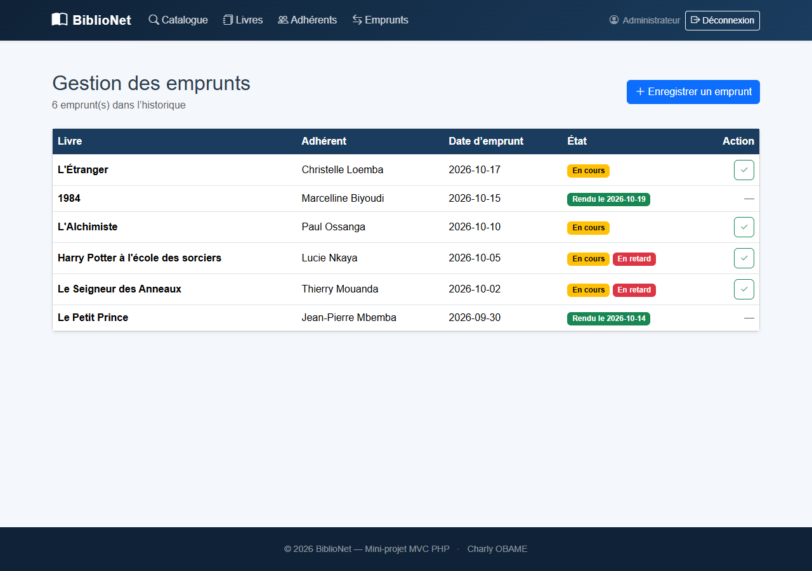
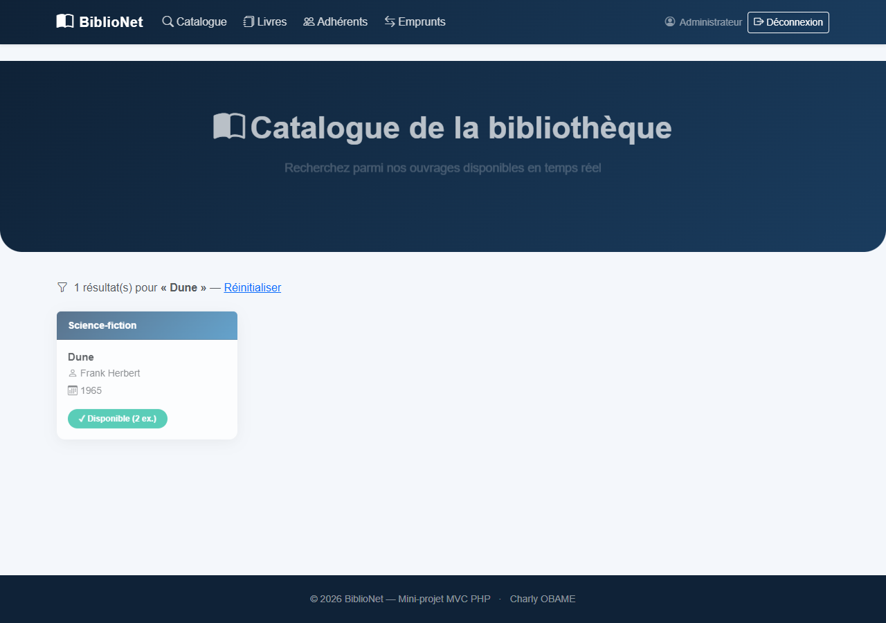

# BiblioNet — Bilan du Jour 3

**Fonctionnalités 2 et préparation de la mise en ligne**  
Mini-projet PHP / MySQL — Architecture MVC  
État constaté le 22 octobre 2026  
Équipe : noms des membres à compléter

## Objectifs du Jour 3

Le Jour 3 porte sur le catalogue public avec recherche, la gestion des emprunts et des retours, ainsi que la préparation de la première mise en ligne.

## Fonctionnalités réalisées

- Le catalogue public affiche les livres et leur disponibilité calculée.
- La recherche filtre les livres par titre ou auteur.
- Le bibliothécaire connecté peut enregistrer un emprunt et saisir un retour.
- L’historique affiche les prêts actifs et rendus; un prêt de plus de 14 jours est signalé comme retard.
- Un emprunt est refusé lorsqu’aucun exemplaire n’est disponible.

La règle de disponibilité est calculée à partir du nombre d’exemplaires et des emprunts dont `date_retour` est `NULL`. Le modèle verrouille la ligne du livre pendant la création de l’emprunt afin d’éviter de dépasser le stock lors de requêtes simultanées.

## Architecture et sécurité

Les routes sont déclarées dans le front controller. Le contrôleur d’emprunts protège les pages par authentification; les créations et retours utilisent POST avec un jeton CSRF. Les modèles effectuent les opérations SQL avec PDO et les vues échappent les valeurs affichées.

## Vérifications locales

- Accès à la route de gestion sans session : redirection vers la connexion.
- Formulaire d’emprunt : livres disponibles et adhérents chargés.
- Recherche « Dune » : un résultat affiché avec deux exemplaires disponibles.
- Test du modèle : création, refus hors stock, retour, refus du double retour, disponibilité restaurée et historique.
- Les six emprunts de démonstration sont affichés dans l’historique local.

## État de la mise en ligne

La version est publiée sur https://biblionet.ct.ws/ via GitHub Actions et FTPS vers InfinityFree. Le catalogue public répond en HTTP 200; les recherches par titre et auteur fonctionnent sur des ouvrages présents. « Dune » n’est pas présent dans le catalogue de production et renvoie donc zéro résultat, contrairement au jeu local. La recherche « Madame Bovary » renvoie deux fiches, ce qui révèle un doublon de données à corriger. L’accès visiteur à `/emprunts` est redirigé vers la page de connexion.

Quatorze cartes de livres sont actuellement visibles sur le site public, alors que phpMyAdmin affichait 18 lignes dans `livres`. Il reste à vérifier que le site utilise la même base et à nettoyer les doublons. Les opérations d’emprunt et de retour ont été testées en local; leur parcours complet en production avec une session bibliothécaire reste à vérifier.

Les noms des membres et l’établissement restent à compléter.